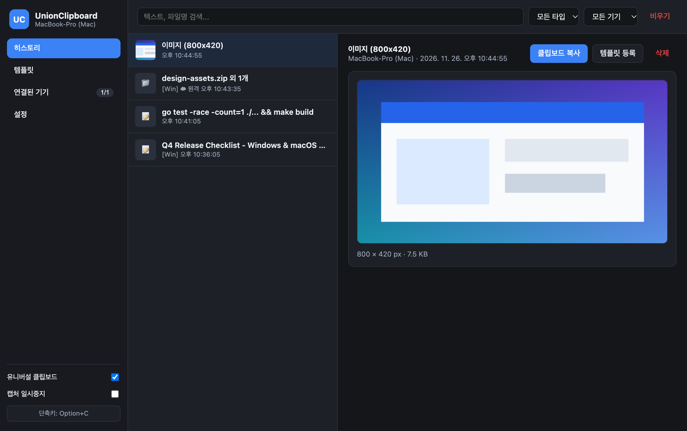
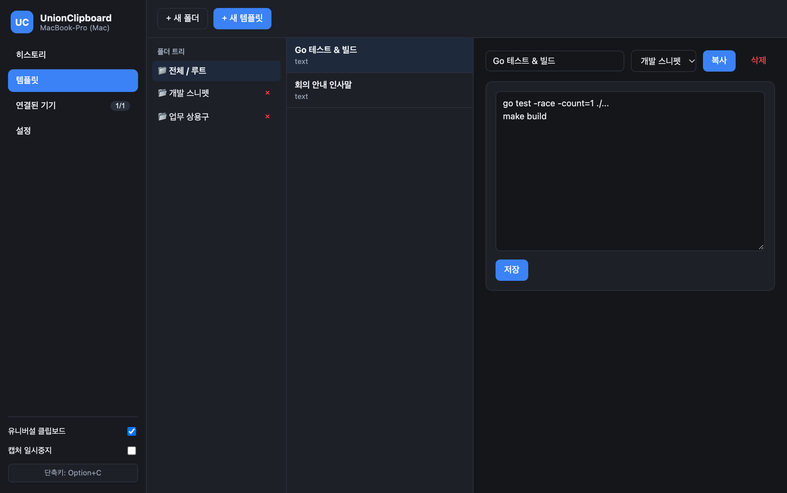
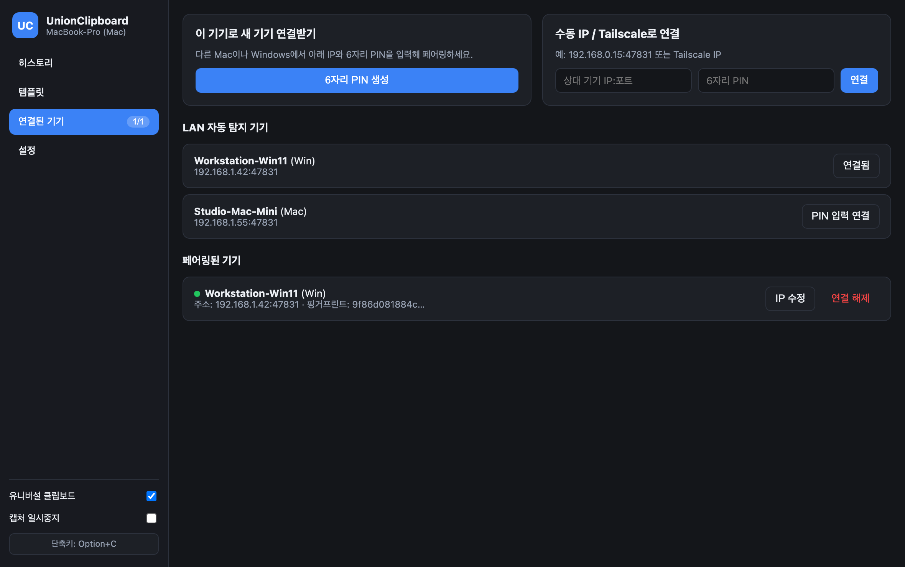
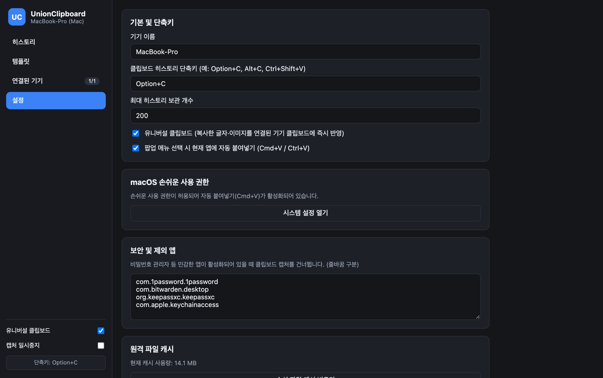
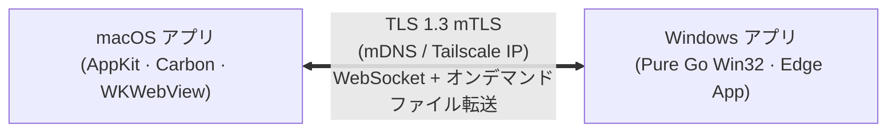

# UnionClipboard

[English](README.md) | [한국어](README.ko.md) | **日本語** | [简体中文](README.zh.md)

**macOS** と **Windows** の間で、複数の**テキスト・画像・ファイル／フォルダのクリップボード履歴と定型文（テンプレート）**をカーソル位置のポップアップメニューから即座に呼び出し、**サーバー不要・TLS 1.3 暗号化 P2P** で自動共有できる軽量デスクトップユーティリティです。

---

## 主な機能

- **ネイティブ・クイックペーストメニュー (`Option+C` / `Alt+C`)**: カーソルやテキストキャレット位置に履歴とテンプレートツリーを表示し、キー選択（`1–9`, `0`, `A–Z`）で即座に復元・自動貼り付けを行います。
- **テキスト・画像・ファイル／フォルダ対応**:
  - **テキスト**: UTF-8 の即時同期およびビューア上での直接編集
  - **画像**: macOS (`PNG`/`TIFF`) と Windows (`PNG`/`CF_DIB`) 間のロスレス自動変換、ポップアップとビューアでのサムネイル表示
  - **ファイル／フォルダ（オンデマンド転送）**: コピー時はメタデータのみを即時同期し、相手側で貼り付けを選択したときにのみ元端末から直接ストリーミング（フォルダは tar ストリーム＋Zip-Slip 対策済み）でダウンロードします。
- **ユニバーサルクリップボード切替**: 有効にするとコピーしたテキスト・画像を相手端末のシステムクリップボードへ即時に反映します（ループ防止機能内蔵）。
- **同期対応テンプレートフォルダ**: よく使う定型文やコマンドをフォルダ分けして管理し、ペアリング済み端末間で同期します。
- **サーバーレス暗号化 P2P**:
  - mDNS (`_unionclip._tcp`) による LAN 自動検出および手動 IP / Tailscale アドレス指定に対応
  - ECDSA P-256 デバイス証明書、**TLS 1.3 相互認証 (mTLS)**、**6桁 PIN チャネルバインドペアリング**
- **プライバシー保護**: パスワードマネージャー（1Password、Bitwarden、KeePassXC、キーチェーンアクセス）や秘匿クリップボード属性を自動除外し、ワンクリックで監視を一時停止できます。

---

## スクリーンショット

| クリップボード履歴・プレビュー | テンプレートフォルダツリー |
| :---: | :---: |
|  |  |

| デバイス接続 (mDNS & 6桁 PIN) | 設定・除外アプリ管理 |
| :---: | :---: |
|  |  |

---

## アーキテクチャ



- **外部サーバーやクラウドアカウントは不要です**：すべてのデータは各端末のローカル SQLite に保存されます。
- **macOS (`darwin/arm64`)**: Go コア + Objective-C (`cgo`) ネイティブブリッジ（`NSStatusBar`, `NSMenu`, `NSPasteboard`, Carbon ホットキー, `CGEvent`, `WKWebView`）
- **Windows (`windows/amd64`)**: 単一実行ファイル（`CGO_ENABLED=0` Pure Go Win32 API + Edge アプリモードビューア）

---

## インストールとビルド

### 1. リリースバイナリの入手
[GitHub Releases](https://github.com/shinepcs/UnionClipboard/releases) からダウンロードできます。
- **macOS (Apple Silicon)**: `UnionClipboard-v1.0.0-macos-arm64.zip` を解凍し、`UnionClipboard.app` をアプリケーションフォルダへ移動して起動します。
- **Windows (64-bit)**: `UnionClipboard-v1.0.0-windows-amd64.exe` をそのまま実行します（ファイアウォール確認が出たらプライベートネットワークを許可してください）。

> **macOS 初回起動時の注意**: アドホック署名ビルドのため Gatekeeper の警告が表示された場合は、右クリック → **開く**、または `xattr -cr /Applications/UnionClipboard.app` を実行してください。  
> ポップアップ選択後の自動 `Cmd+V` 貼り付けを利用するには、ビューアの **設定** から macOS **アクセシビリティ権限**を許可してください。

### 2. ソースからのビルド
必要環境: **Go 1.26+**（macOS ビルドには Xcode Command Line Tools が必要です。Windows 用 `.exe` は macOS/Linux からクロスコンパイル可能です）

```bash
# 単体テストおよび 2ノード mTLS 統合テストを実行
make test

# macOS .app バンドルをビルド -> dist/UnionClipboard.app
make build-mac

# Windows 64-bit 実行ファイルをクロスコンパイル -> dist/UnionClipboard.exe
make build-win

# 両OS向けにビルド
make build
```

---

## Mac ↔ Windows のペアリング手順

1. Mac と Windows の両方で **UnionClipboard** を起動します。
2. 片方の端末で **연결된 기기（接続済みデバイス）** タブを開き、**6자리 PIN 생성（6桁 PIN を生成）** をクリックします（有効期限 3 分、誤入力 5 回でロック）。
3. もう一方の端末で自動検出されたデバイスを選択（または `IP:47831` / Tailscale IP を入力）し、6桁 PIN を入力して **연결（接続）** をクリックします。
4. ペアリング完了後、テキスト・画像・テンプレート・ファイル一覧がリアルタイムで同期されます。

---

## デフォルトショートカット

| 操作 | macOS | Windows |
| :--- | :--- | :--- |
| 履歴ポップアップを開く | `Option + C` | `Alt + C` |
| ポップアップ項目を素早く選択 | `1–9`, `0`, `A–Z` | `1–9`, `0`, `A–Z` |
| ビューアを閉じる（常駐継続） | `Cmd + W` | `Alt + F4` |

ショートカットは **設定** タブから自由に変更できます（例: `Ctrl+Shift+V`）。

---

## ライセンス

[MIT License](LICENSE) の下で公開されています。
