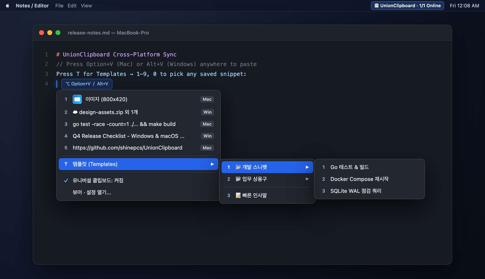
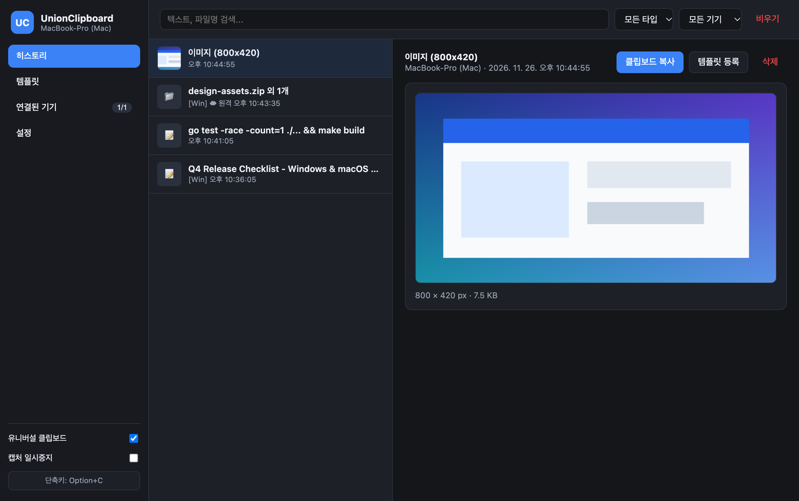
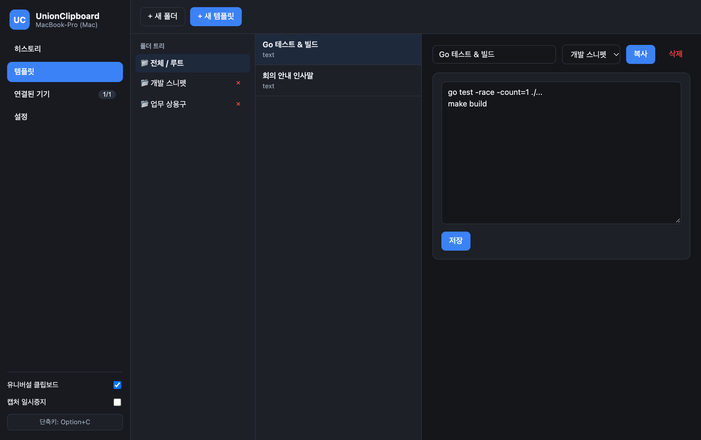
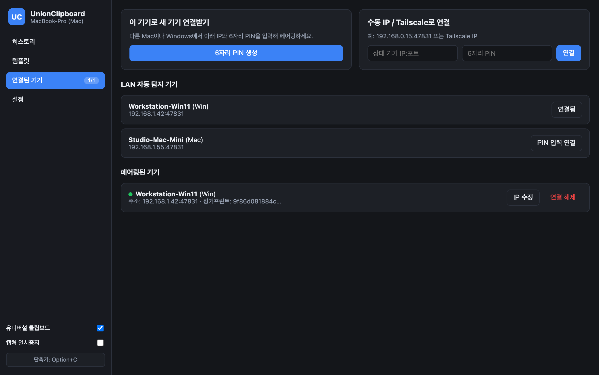
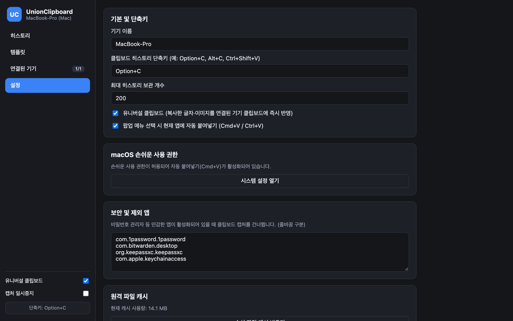
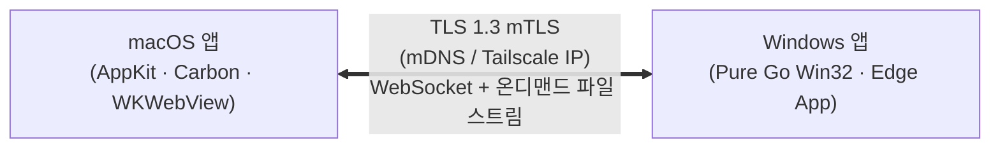

# UnionClipboard

[English](README.md) | **한국어** | [日本語](README.ja.md) | [简体中文](README.zh.md)

**macOS**와 **Windows**를 함께 사용하는 환경에서 별도 서버나 클라우드 없이, 여러 개의 **글자·이미지·파일/폴더 히스토리와 템플릿(상용구)**을 단축키 팝업으로 즉시 참조·붙여넣기하고 암호화 동기화하는 경량 데스크톱 유틸리티입니다.

---

## 주요 기능

- **커서 위치 빠른 붙여넣기 팝업 (`Option+V` / `Alt+V`)**: 작업 중인 앱의 마우스 커서나 입력 캐럿 위치에 히스토리·템플릿 메뉴를 즉시 띄우고, 숫자/문자 키(`1–9`, `0`, `A–S`, `U–Z`) 또는 `T` → `1–9`, `0` 키로 템플릿 하위 항목까지 키보드만으로 바로 붙여넣습니다.
- **글자 · 이미지 · 파일/폴더 크로스 플랫폼 지원**:
  - **글자**: UTF-8 텍스트 실시간 동기화 및 뷰어 내 직접 수정
  - **이미지**: macOS(`PNG`/`TIFF`) ↔ Windows(`PNG`/`CF_DIB`) 무손실 자동 변환, 팝업 및 뷰어 썸네일 지원
  - **파일 및 폴더 (온디맨드 전송)**: 복사 시점에는 파일 목록 메타데이터만 즉시 동기화해 네트워크 부담을 없애고, 상대 기기에서 붙여넣기를 선택할 때만 원본 기기에서 안전하게 스트리밍(폴더는 tar 스트리밍 및 Zip-Slip 방지) 다운로드합니다.
- **유니버설 클립보드 모드 토글**: 켜져 있을 때 한 기기에서 복사한 글자·이미지를 상대 기기 시스템 클립보드에 즉시 반영합니다 (무한 루프 방지 내장).
- **템플릿(상용구) 폴더 관리 & 동기화**: 자주 쓰는 문구, 명령어, 이미지를 폴더 트리별로 저장하고 모든 연결 기기에 동기화합니다.
- **서버 없는 종단간 암호화 P2P 동기화**:
  - mDNS(`_unionclip._tcp`) LAN 자동 탐지 및 수동 IP / Tailscale 주소 연결 지원
  - 기기별 ECDSA P-256 인증서, **TLS 1.3 상호 인증(mTLS)** 핑거프린트 피닝, **6자리 PIN 채널 바인딩 페어링**
  - **연결 자동 유지**: 한 번 페어링된 기기는 한쪽이 의도적으로 연결을 해제하기 전까지 절전 복귀·재시작·네트워크 변경 시에도 자동으로 재연결됩니다.
- **프라이버시 & 보안 필터**: 비밀번호 관리자(1Password, Bitwarden, KeePassXC, 키체인 접근) 및 시스템 민감 클립보드 자동 제외, 원클릭 일시중지 지원.

---

## 스크린샷

### 빠른 붙여넣기 팝업 메뉴 (`Option+V` / `Alt+V`)
작업 중인 앱 어디서든 `Option+V` (macOS) 또는 `Alt+V` (Windows)를 누르면 커서/캐럿 위치에 클립보드 히스토리와 템플릿 폴더 트리가 즉시 열립니다:



### 관리 뷰어 창

| 클립보드 히스토리 및 미리보기 | 템플릿 폴더 트리 |
| :---: | :---: |
|  |  |

| 기기 연결 (mDNS 및 6자리 PIN) | 설정 및 제외 앱 관리 |
| :---: | :---: |
|  |  |

---

## 동작 구조



- **외부 서버나 계정이 필요 없습니다**: 모든 히스토리와 파일 캐시는 각 기기의 로컬 SQLite 저장소에만 보관됩니다.
- **macOS (`darwin/arm64`)**: Go 코어 + Objective-C(`cgo`) 네이티브 브리지 (`NSStatusBar`, `NSMenu`, `NSPasteboard`, Carbon 단축키, `CGEvent`, `WKWebView`)
- **Windows (`windows/amd64`)**: 단일 `.exe` 바이너리 (`CGO_ENABLED=0` Pure Go Win32 API + Edge 앱 창 뷰어)

---

## 설치 및 빌드

### 1. 릴리스 파일 다운로드
[GitHub Releases](https://github.com/shinepcs/UnionClipboard/releases)에서 OS에 맞는 파일을 내려받으세요.
- **macOS (Apple Silicon)**: `UnionClipboard-v1.0.0-macos-arm64.zip` 압축 해제 후 `UnionClipboard.app`을 응용 프로그램 폴더로 이동해 실행합니다.
- **Windows (64비트)**: `UnionClipboard-v1.0.0-windows-amd64.exe`를 바로 실행합니다 (Windows 방화벽 창이 뜨면 개인 네트워크 허용 선택).

> **macOS 처음 실행 안내**: 공증되지 않은 오픈소스 빌드이므로 Gatekeeper 경고가 표시되면 우클릭 → **열기** 또는 `xattr -cr /Applications/UnionClipboard.app` 실행 후 열어주세요.  
> 팝업에서 항목 선택 시 자동 `Cmd+V` 붙여넣기까지 수행하려면 뷰어 → **설정** → **macOS 손쉬운 사용 권한**을 허용해 주세요.

### 2. 소스 코드에서 직접 빌드
필요 환경: **Go 1.26+** (macOS 빌드는 Xcode CLT 필요, Windows `.exe`는 Mac/Linux에서 바로 크로스 컴파일 가능)

```bash
# 단위 테스트 및 2노드 mTLS 종단간 통합 테스트 실행
make test

# macOS .app 번들 빌드 -> dist/UnionClipboard.app
make build-mac

# Windows 64비트 실행 파일 크로스 컴파일 -> dist/UnionClipboard.exe
make build-win

# 양대 OS 모두 빌드
make build
```

---

## Mac ↔ Windows 기기 연결 방법

1. Mac과 Windows에서 각각 **UnionClipboard**를 실행합니다 (실행 시 뷰어 창이 열리며, 닫은 뒤에도 메뉴바/트레이 아이콘에서 언제든 다시 열 수 있습니다).
2. 한쪽 기기의 **연결된 기기** 탭에서 **6자리 PIN 생성**을 누릅니다 (3분 유효, 5회 오입력 시 자동 잠금).
3. 다른 기기의 **연결된 기기** 탭에서 LAN 자동 탐지 기기를 선택하거나 `상대IP:47831`과 6자리 PIN을 입력해 **연결**을 누릅니다.
4. 연결이 완료되면 글자·이미지·템플릿·파일 목록이 실시간으로 동기화됩니다.

---

## 기본 단축키

| 기능 | macOS | Windows |
| :--- | :--- | :--- |
| 클립보드 히스토리 팝업 열기 | `Option + V` | `Alt + V` |
| 히스토리 항목 빠른 선택 | `1–9`, `0`, `A–S`, `U–Z` | `1–9`, `0`, `A–S`, `U–Z` |
| 템플릿 진입 → 하위 항목 선택 | `T` → `1–9`, `0` | `T` → `1–9`, `0` |
| 뷰어 창 닫기 (트레이 상주 유지) | `Cmd + W` | `Alt + F4` |

단축키는 **설정** 탭의 **단축키 녹화** 버튼으로 원하는 키 조합으로 변경할 수 있습니다.

---

## 라이선스

[MIT License](LICENSE)에 따라 배포됩니다.
