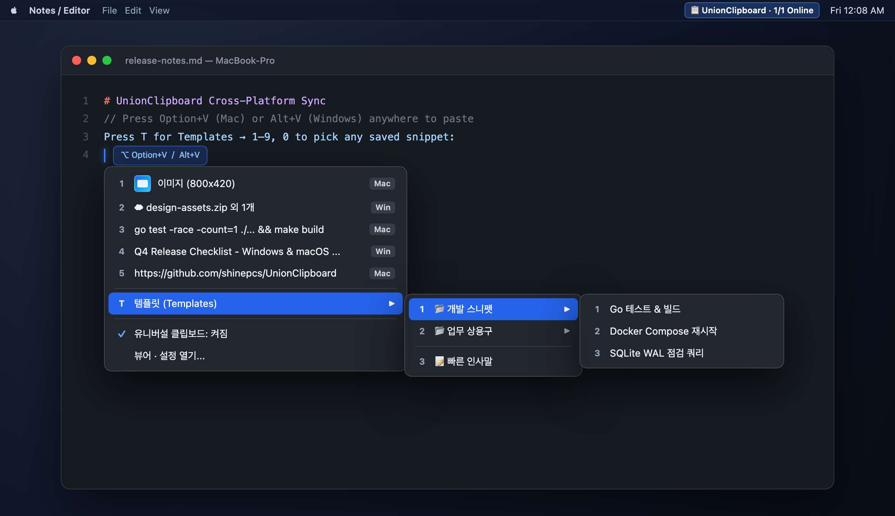
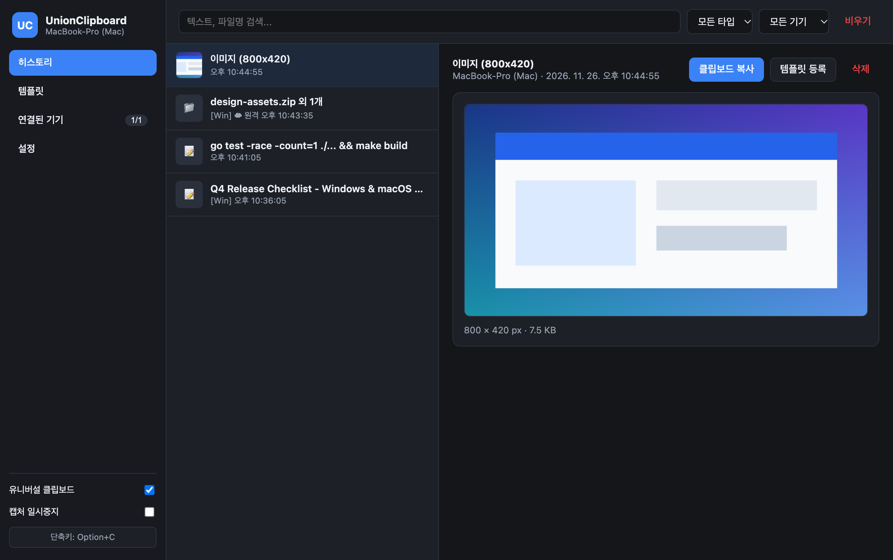
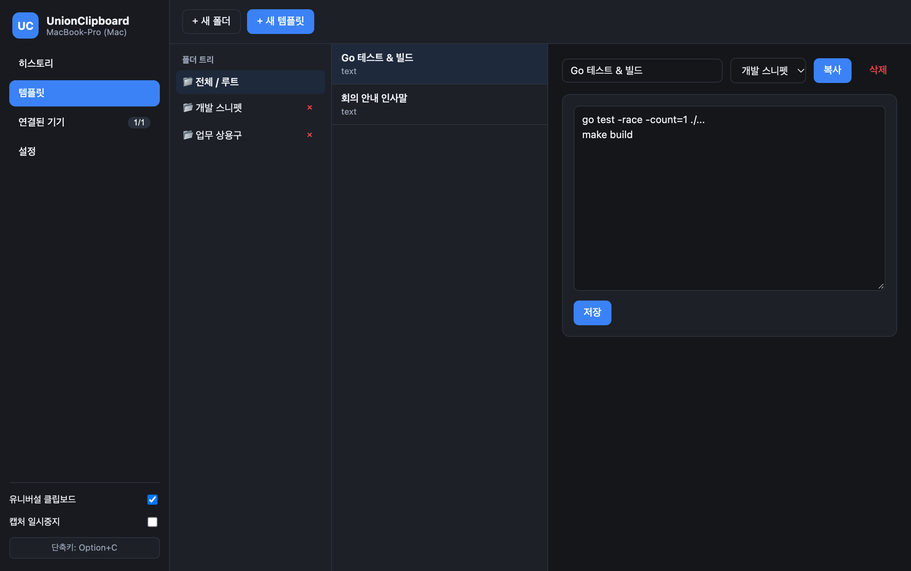
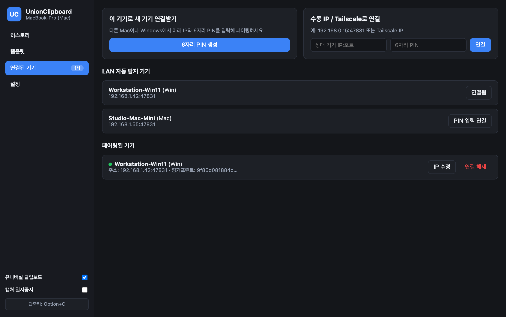
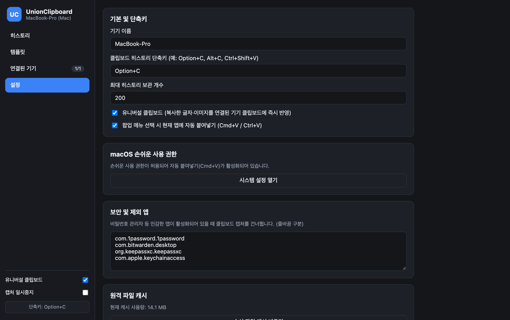
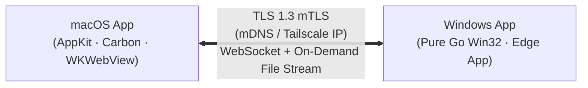

# UnionClipboard

**English** | [한국어](README.ko.md) | [日本語](README.ja.md) | [简体中文](README.zh.md)

A lightweight, server-free cross-platform clipboard manager and encrypted P2P sync utility for **macOS** and **Windows**.

Share multiple **text snippets, images, and files/folders** seamlessly across your Mac and Windows machines on the same network (LAN, Wi-Fi, or Tailscale) — with a native quick-paste popup menu at your cursor, organized templates, and end-to-end TLS 1.3 security.

---

## Key Features

- **Native Quick-Paste Popup Menu (`Option+V` / `Alt+V`)**: Opens a fast, keyboard-accessible history & template menu right at your cursor or text caret. Select any history item (`1–9`, `0`, `A–S`, `U–Z`), or press `T` to jump into **Templates** and `1–9`, `0` to pick folders and saved snippets via keyboard.
- **Text, Images & Files/Folders**:
  - **Text**: Instant UTF-8 sync and inline editing.
  - **Images**: Automatic lossless conversion between macOS (`PNG`/`TIFF`) and Windows (`PNG`/`CF_DIB`), with thumbnails in both the popup menu and viewer.
  - **Files & Folders (On-Demand Streaming)**: Only file metadata is synced immediately when copied. Actual file bytes (or tar-streamed directories with Zip-Slip protection) are downloaded directly from the origin machine only when you choose to paste them.
- **Universal Clipboard Toggle**: Optionally mirror copied text and images directly into the paired device's system clipboard (with built-in echo-loop suppression).
- **Synced Template Folders**: Organize frequently used phrases, commands, and snippets into folders and sync them across all paired devices.
- **Zero-Server Encrypted P2P**:
  - Automatic LAN discovery via mDNS (`_unionclip._tcp`) plus manual IP / Tailscale address support.
  - Self-signed ECDSA P-256 device certificates, **TLS 1.3 mutual authentication (mTLS)** with certificate fingerprint pinning, and **6-digit PIN channel-bound pairing**.
  - **Persistent Auto-Reconnect**: Once paired, devices stay connected and automatically reconnect across sleep, Wi-Fi/DHCP changes, or restarts until intentionally unpaired.
- **Privacy Safeguards**: Automatically skips concealed/transient clipboard entries and foreground password managers (1Password, Bitwarden, KeePassXC, Keychain Access), plus one-click capture pause.

---

## Screenshots

### Quick-Paste Popup Menu (`Option+V` / `Alt+V`)
Press `Option+V` (macOS) or `Alt+V` (Windows) in any app to open the clipboard history & template tree right at your cursor/caret:



### Management Viewer

| Clipboard History & Preview | Template Folder Tree |
| :---: | :---: |
|  |  |

| Device Pairing (mDNS & 6-Digit PIN) | Settings & Excluded Apps |
| :---: | :---: |
|  |  |

---

## Architecture



- **No central server or cloud account required** — all history, blobs, and templates stay strictly on your own devices in local SQLite storage.
- **macOS (`darwin/arm64`)**: Go core + Objective-C (`cgo`) native bridge (`NSStatusBar`, `NSMenu`, `NSPasteboard`, Carbon global hotkeys, `CGEvent`, `WKWebView`).
- **Windows (`windows/amd64`)**: Single-binary Pure Go (`CGO_ENABLED=0`) using Win32 APIs (`Shell_NotifyIconW`, `TrackPopupMenuEx`, `WM_CLIPBOARDUPDATE`, `RegisterHotKey`, `SendInput`) and Edge App mode viewer.

---

## Installation & Usage

### 1. Download Release Binaries
Grab the latest release from [GitHub Releases](https://github.com/shinepcs/UnionClipboard/releases):
- **macOS (Apple Silicon)**: `UnionClipboard-v1.0.0-macos-arm64.zip` → unzip and move `UnionClipboard.app` to `/Applications`.
- **Windows (x64)**: `UnionClipboard-v1.0.0-windows-amd64.exe` → run directly (allow Private Network access if Windows Firewall prompts).

> **macOS First Launch Note**: Because the binary is ad-hoc signed, if Gatekeeper warns on first open, right-click `UnionClipboard.app` → **Open**, or run `xattr -cr /Applications/UnionClipboard.app`.  
> To enable automatic `Cmd+V` pasting after selecting an item from the popup menu, grant **Accessibility** permission in **Settings → macOS Accessibility**.

### 2. Build from Source
Requirements: **Go 1.26+** (Xcode Command Line Tools required only for macOS build; Windows `.exe` cross-compiles purely from macOS or Linux).

```bash
# Run unit tests and 2-node mTLS integration tests
make test

# Build macOS .app bundle -> dist/UnionClipboard.app
make build-mac

# Cross-compile Windows 64-bit binary -> dist/UnionClipboard.exe
make build-win

# Build both platforms
make build
```

---

## Pairing Mac & Windows

1. Launch **UnionClipboard** on both your Mac and Windows PC (the management viewer opens automatically; you can also reopen it anytime from the menu bar / system tray icon).
2. On the first device, open the **연결된 기기 (Connected Devices)** tab and click **6자리 PIN 생성 (Generate 6-Digit PIN)** (valid for 3 minutes, rate-limited to 5 attempts).
3. On the second device, select the auto-discovered LAN peer (or enter `IP:47831` / Tailscale IP manually), type the 6-digit PIN, and click **연결 (Connect)**.
4. Once paired, text, images, templates, and file metadata sync automatically in real time.

---

## Default Shortcuts

| Action | macOS | Windows |
| :--- | :--- | :--- |
| Open Quick-Paste Popup Menu | `Option + V` | `Alt + V` |
| Quick Select History Item | `1–9`, `0`, `A–S`, `U–Z` | `1–9`, `0`, `A–S`, `U–Z` |
| Open Templates → Pick Item | `T` → `1–9`, `0` | `T` → `1–9`, `0` |
| Close Viewer Window (Keep in Tray) | `Cmd + W` | `Alt + F4` |

Shortcuts can be customized directly via the **Record Shortcut** button in the **Settings** tab.

---

## License

Released under the [MIT License](LICENSE).
