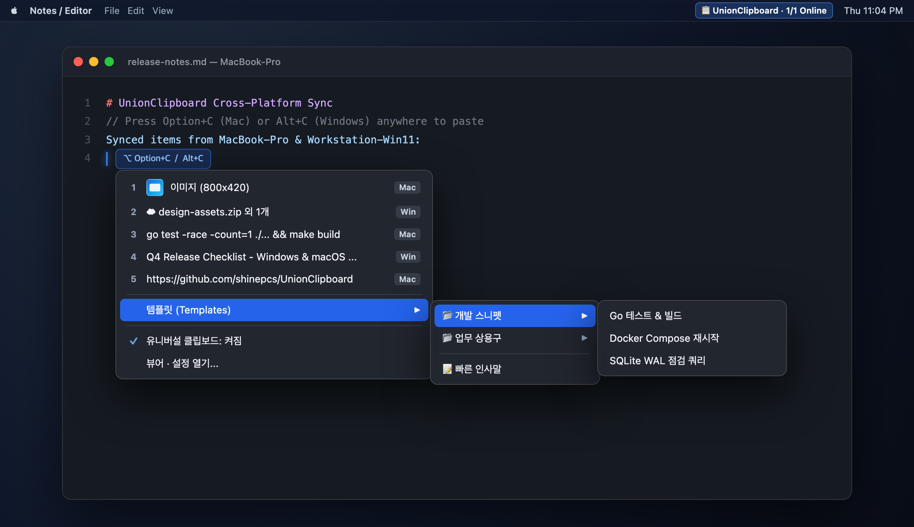
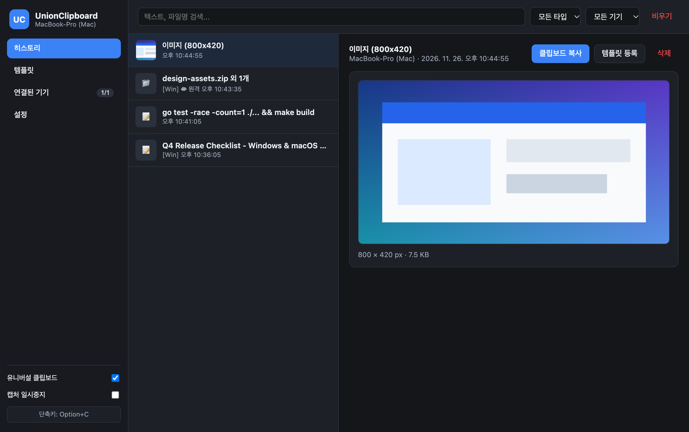
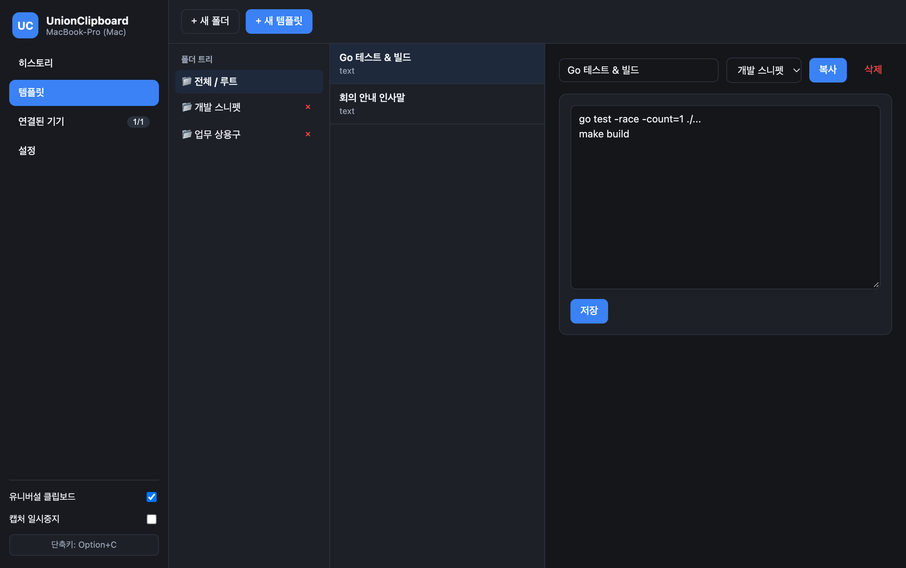
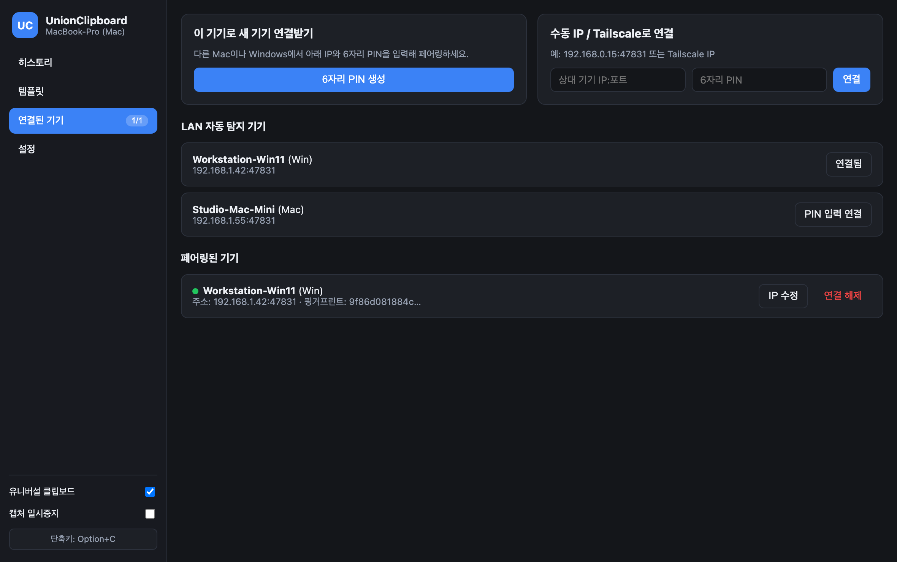
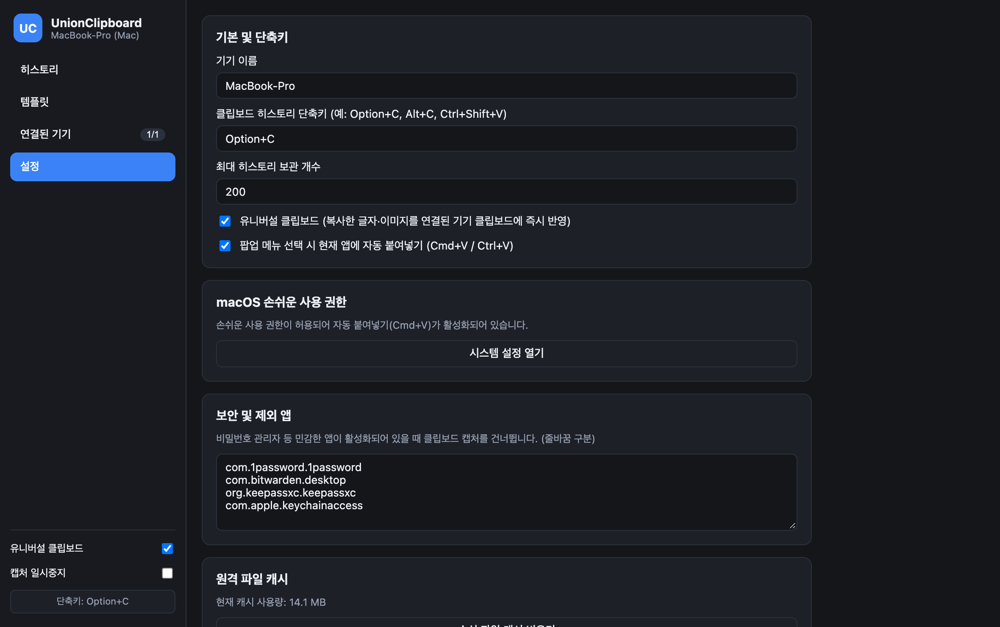
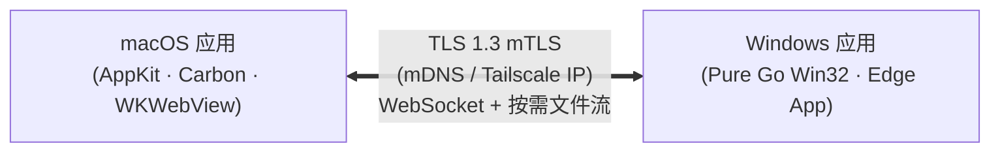

# UnionClipboard

[English](README.md) | [한국어](README.ko.md) | [日本語](README.ja.md) | **简体中文**

一款无需中央服务器、跨 **macOS** 与 **Windows** 的轻量级剪贴板历史与加密点对点（P2P）同步工具。

在同一网络（局域网、Wi-Fi 或 Tailscale）下的 Mac 与 Windows 之间自动安全同步多条**文本、图片、文件/文件夹**记录与常用模板，并支持在光标处呼出快捷菜单一键粘贴。

---

## 核心特性

- **原生快捷粘贴菜单 (`Option+C` / `Alt+C`)**：在鼠标光标或文本输入光标处即时弹出历史记录与模板菜单，使用快捷键（`1–9`、`0`、`A–Z`）即可恢复并自动粘贴到当前应用。
- **全面支持文本、图片与文件/文件夹**：
  - **文本**：UTF-8 实时同步，支持在管理界面中直接编辑。
  - **图片**：macOS (`PNG`/`TIFF`) 与 Windows (`PNG`/`CF_DIB`) 之间自动无损转换，菜单与管理界面均提供缩略图预览。
  - **文件与文件夹（按需传输）**：复制文件时仅立即同步元数据列表；仅当另一台设备选择粘贴时，才从源设备直接流式下载（文件夹采用 tar 流式传输并具备 Zip-Slip 防护）。
- **通用剪贴板开关**：开启后，一台设备复制的文本或图片会即时同步到配对设备的系统剪贴板（内置防回环保护）。
- **模板文件夹同步**：支持将常用文本、命令与图片按文件夹分类管理，并在所有已配对设备间同步。
- **无服务器端到端加密 P2P**：
  - 基于 mDNS (`_unionclip._tcp`) 自动发现局域网设备，同时支持手动输入 IP 或 Tailscale 地址。
  - 设备独立 ECDSA P-256 证书、**TLS 1.3 双向认证 (mTLS)** 指纹锁定，以及 **6 位 PIN 码通道绑定配对**。
- **隐私保护**：自动跳过密码管理器（1Password、Bitwarden、KeePassXC、钥匙串访问）和系统敏感标记内容，并支持一键暂停捕获。

---

## 界面截图

### 快捷粘贴弹出菜单 (`Option+C` / `Alt+C`)
在任意应用中按下 `Option+C`（macOS）或 `Alt+C`（Windows），即可在鼠标或输入光标处呼出剪贴板历史记录与模板文件夹树:



### 管理视图界面

| 剪贴板历史与预览 | 模板文件夹树 |
| :---: | :---: |
|  |  |

| 设备配对 (mDNS 与 6 位 PIN) | 设置与排除应用 |
| :---: | :---: |
|  |  |

---

## 系统架构



- **无需外部服务器或云账号**：所有历史记录、图片和模板均保存在本地 SQLite 数据库中。
- **macOS (`darwin/arm64`)**：Go 核心 + Objective-C (`cgo`) 原生桥接（`NSStatusBar`、`NSMenu`、`NSPasteboard`、Carbon 全局热键、`CGEvent`、`WKWebView`）。
- **Windows (`windows/amd64`)**：单文件 Pure Go（`CGO_ENABLED=0`）Win32 原生实现 + Edge 应用窗口管理界面。

---

## 安装与编译

### 1. 下载发行版
前往 [GitHub Releases](https://github.com/shinepcs/UnionClipboard/releases) 下载对应平台程序：
- **macOS (Apple Silicon)**：下载 `UnionClipboard-v1.0.0-macos-arm64.zip`，解压后将 `UnionClipboard.app` 拖入“应用程序”文件夹。
- **Windows (64位)**：直接运行 `UnionClipboard-v1.0.0-windows-amd64.exe`（若弹出防火墙提示，请允许专用网络访问）。

> **macOS 首次运行提示**：由于二进制使用临时签名，若系统弹出 Gatekeeper 提示，请右键点击 `UnionClipboard.app` → **打开**，或执行 `xattr -cr /Applications/UnionClipboard.app`。  
> 如需在选择菜单项后自动发送 `Cmd+V` 粘贴，请在界面 **设置** 中授予 **辅助功能 (Accessibility)** 权限。

### 2. 从源码编译
环境要求：**Go 1.26+**（编译 macOS 需 Xcode Command Line Tools；Windows `.exe` 可在 macOS/Linux 上直接交叉编译）。

```bash
# 运行单元测试与双节点 mTLS 集成测试
make test

# 编译 macOS .app 应用包 -> dist/UnionClipboard.app
make build-mac

# 交叉编译 Windows 64位可执行文件 -> dist/UnionClipboard.exe
make build-win

# 同时编译两个平台
make build
```

---

## Mac ↔ Windows 配对方法

1. 在 Mac 和 Windows 上分别启动 **UnionClipboard**。
2. 在其中一台设备的 **연결된 기기（已连接设备）** 页面点击 **6자리 PIN 생성（生成 6 位 PIN）**（有效期 3 分钟，错误 5 次自动锁定）。
3. 在另一台设备的 **연결된 기기** 页面选择自动发现的设备（或手动输入 `IP:47831` / Tailscale IP），输入 6 位 PIN 码后点击 **연결（连接）**。
4. 配对成功后，文本、图片、模板和文件列表将实时同步。

---

## 默认快捷键

| 操作 | macOS | Windows |
| :--- | :--- | :--- |
| 打开快捷粘贴菜单 | `Option + C` | `Alt + C` |
| 快速选择菜单项 | `1–9`, `0`, `A–Z` | `1–9`, `0`, `A–Z` |
| 关闭窗口（保持后台运行） | `Cmd + W` | `Alt + F4` |

可在 **设置** 页面自定义快捷键（例如 `Ctrl+Shift+V`）。

---

## 开源协议

基于 [MIT License](LICENSE) 开源。
